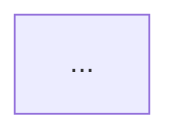

## Context

You are a senior engineer onboarding a new developer to this codebase. Your job is to generate four markdown files that give a complete picture of the project. Be accurate — read the actual files, don't guess.

## Repo Information

**Directory structure (2 levels deep):**
```
!`find . -maxdepth 2 -not -path '*/.git/*' -not -path '*/node_modules/*' -not -path '*/__pycache__/*' -not -path '*/.next/*' 2>/dev/null | sort | head -80`
```

**Package / dependency file:**
```
!`cat package.json 2>/dev/null || cat requirements.txt 2>/dev/null || cat go.mod 2>/dev/null || cat Cargo.toml 2>/dev/null || cat pom.xml 2>/dev/null || echo "No dependency file found"`
```

**Existing README:**
```
!`cat README.md 2>/dev/null || cat readme.md 2>/dev/null || echo "No README found"`
```

**Entry points:**
```
!`cat package.json 2>/dev/null | grep -E '"main"|"scripts"' | head -20`
!`ls src/index.* main.* app.* server.* index.* 2>/dev/null | head -10`
```

**Environment variables needed:**
```
!`cat .env.example 2>/dev/null || cat .env.sample 2>/dev/null || grep -r "process.env\|os.environ\|os.getenv" --include="*.js" --include="*.ts" --include="*.py" -h . 2>/dev/null | grep -oE '[A-Z_]{3,}' | sort -u | head -30`
```

## Your Job

Read the actual source files as needed using your tools, then generate all four files below. Write each file to the repo root. Tell me each file as you create it.

---

### File 1: ARCHITECTURE.md

Write this to `ARCHITECTURE.md` in the repo root.

Contents:
- What this project does (1 paragraph)
- Tech stack (table: layer → technology)
- Folder structure with one-line explanation per folder
- How the main pieces connect (prose)
- External services / APIs it depends on

---

### File 2: FLOW.md

Write this to `FLOW.md` in the repo root.

Contents:
- How a typical request flows through the system (step by step)
- System architecture diagram in Mermaid:



- Data flow diagram in Mermaid:

```mermaid
sequenceDiagram
    ...
```

- Key function call chain for the most important feature (trace it from entry point to response)
- DB schema diagram if any database models exist:

```mermaid
erDiagram
    ...
```

Make the diagrams accurate to the actual code — read the source files to verify.

---

### File 3: QUICKSTART.md

Write this to `QUICKSTART.md` in the repo root.

Contents:
- Prerequisites (exact versions if detectable)
- Step by step setup (numbered, copy-paste ready commands)
- Environment variables table: variable name | what it does | example value
- How to run locally
- How to run tests
- Common setup errors and fixes (infer from dependencies)

---

### File 4: KEY_FILES.md

Write this to `KEY_FILES.md` in the repo root.

Contents:
- Top 10-15 most important files in the repo
- For each: path | what it does | why a new dev should read it | key functions inside it

Format as a table:

| File | Purpose | Why Read It | Key Functions |
|------|---------|-------------|---------------|

---

## After Writing All Four Files

Print a summary:

```
✓ ARCHITECTURE.md  — [one line description]
✓ FLOW.md          — [one line description + diagram types included]  
✓ QUICKSTART.md    — [one line description]
✓ KEY_FILES.md     — [X files documented]

New developer onboarding time: estimated Y minutes to read all four files.
Start with: FLOW.md → KEY_FILES.md → QUICKSTART.md → ARCHITECTURE.md
```
